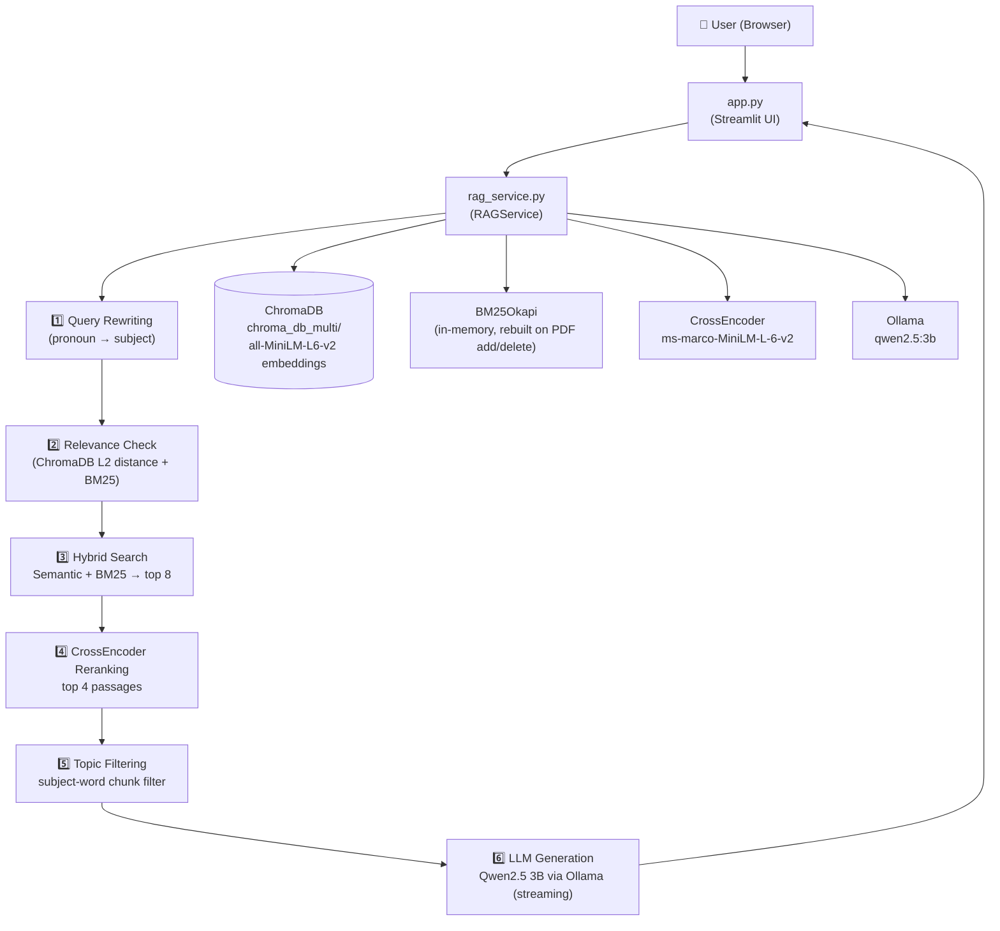

# 🤖 Advanced RAG Chatbot

A production-ready Retrieval-Augmented Generation (RAG) chatbot that answers questions strictly from your own PDF documents. It uses **hybrid search** (dense embeddings + BM25 keyword), **CrossEncoder reranking**, **conversational context resolution**, and a locally-running **Qwen2.5 3B** LLM via Ollama — all served through a Streamlit web UI.

---

## ✨ Features

| Feature | Details |
|---|---|
| **Multi-PDF Knowledge Base** | Upload, index, and delete PDFs at runtime directly from the UI |
| **Hybrid Search** | Dense semantic search (all-MiniLM-L6-v2) + BM25 keyword search merged with weighted scoring (60% semantic, 40% keyword) |
| **CrossEncoder Reranking** | ms-marco-MiniLM-L-6-v2 scores and reranks top-8 candidates down to top-4 most relevant passages |
| **Conversational Follow-ups** | Pronoun/reference resolution — "what are its advantages?" correctly resolves "it" to the prior topic |
| **Streaming Answers** | Qwen2.5 3B streams the answer token-by-token directly in the chat |
| **Multi-Conversation Management** | Create, switch, clear, and delete independent chat sessions |
| **Export & Share** | Download current chat as Markdown, JSON, or plain text; copy full transcript; backup all chats as JSON |
| **System Status Panel** | Live display of indexed PDF count and total chunk count |
| **Source Citations** | Each answer shows the source PDF filename and page number |
| **Retrieval Details** | Expandable view showing all reranked passages with scores per question |
| **Safe PDF Deletion** | Deleting a PDF removes all its chunks from ChromaDB and rebuilds the BM25 index |

---

## 🏗️ Architecture



---

## 🔄 RAG Pipeline (Step by Step)

```
User Question
      │
      ▼
[1] Query Rewriting
      Resolves pronouns ("its" → "Python's") using conversation history.
      │
      ▼
[2] Relevance Check
      Queries ChromaDB with L2 distance. If best distance > RELEVANCE_THRESHOLD (1.35)
      AND BM25 max score ≤ 3.0 → returns "not found" immediately.
      │
      ▼
[3] Hybrid Search
      Semantic:  top-10 ChromaDB results, scored via 1 / (1 + distance)
      Keyword:   BM25 top-10 results, normalized to [0, 1]
      Combined:  0.6 × semantic + 0.4 × keyword → top 8 merged results
      │
      ▼
[4] CrossEncoder Reranking
      Scores each (question, passage) pair with ms-marco-MiniLM-L-6-v2.
      Keeps passages within RERANK_SCORE_GAP (3.5) of the top score → top 4.
      │
      ▼
[5] Topic Filtering
      Filters reranked chunks to those containing the identified subject words.
      Falls back to topic-word filtering if no subject is resolved.
      │
      ▼
[6] LLM Generation (Streaming)
      Builds a strict system prompt with the filtered context.
      Streams Qwen2.5 3B output via Ollama.
      Strips <think>…</think> tags and leading "Answer:" from output.
```

---

## 📁 File Structure

```
advanced rag chatbot/
│
├── app.py                        # ✅ Streamlit UI — sole runtime entry point
├── rag_service.py                # ✅ Unified RAG backend (RAGService class + public functions)
│
├── ingestion.py                  # ⚠️  Legacy ingestion helper (not used at runtime)
├── main.py                       # ⚠️  Legacy CLI module (not used at runtime)
│
├── create_basics_pdf.py          # 🛠️  Script to regenerate python_data_science_basics.pdf
├── requirements.txt              # 📦 Python dependencies
├── README.md                     # 📖 This file
│
├── .vscode/
│   └── settings.json             # 🔧 Pylance config (suppresses false import errors)
│
├── data/                         # 📂 PDF documents to index
│   ├── ISLP_website.pdf
│   ├── Python Tutorial.pdf
│   └── python_data_science_basics.pdf
│
├── chroma_db_multi/              # 💾 ChromaDB persistent vector store
│   └── advanced_rag_documents    # Collection (~5,046 chunks)
│
├── venv/                         # 🐍 Python virtual environment
│
├── test_rag_service.py
├── test_ingestion.py
├── test_multiple_pdf.py
├── test_multi_retrieval.py
├── test_uploaded_pdf.py
├── test_uploaded_retrieval.py
├── advanced_retriever.py
├── hybrid_retriever.py
├── hybrid_ranker.py
└── verify_rag_runtime.py
```

> [!NOTE]
> `app.py` imports **only** from `rag_service.py`. `ingestion.py` and `main.py` are legacy files preserved for reference but are not part of the active pipeline.

---

## ⚙️ Configuration Constants (`rag_service.py`)

| Constant | Value | Description |
|---|---|---|
| `EMBEDDING_MODEL` | `sentence-transformers/all-MiniLM-L6-v2` | Dense embedding model |
| `RERANKER_MODEL` | `cross-encoder/ms-marco-MiniLM-L-6-v2` | CrossEncoder reranker |
| `LLM_MODEL` | `qwen2.5:3b` | Local LLM via Ollama |
| `CHUNK_SIZE` | `500` | Characters per chunk |
| `CHUNK_OVERLAP` | `50` | Overlap between adjacent chunks |
| `MAX_BATCH_SIZE` | `500` | Max items per ChromaDB batch operation |
| `RELEVANCE_THRESHOLD` | `1.35` | L2 distance above which results are rejected |
| `RERANK_SCORE_GAP` | `3.5` | CrossEncoder score gap for filtering |
| `COLLECTION_NAME` | `advanced_rag_documents` | ChromaDB collection name |
| `CHROMA_PATH` | `./chroma_db_multi` | ChromaDB persistent storage path |
| `DATA_DIR` | `./data` | PDF storage directory |

---

## 🚀 Setup & Installation

### Prerequisites

- Python 3.10+
- [Ollama](https://ollama.com) installed and running locally

### 1. Create and activate virtual environment

```powershell
python -m venv venv
.\venv\Scripts\Activate.ps1
```

### 2. Install dependencies

```powershell
pip install -r requirements.txt
```

### 3. Pull the LLM model

```powershell
ollama pull qwen2.5:3b
```

### 4. Add your PDFs

Place PDF files in the `data/` folder, **or** upload them directly from the Streamlit UI at runtime.

### 5. Run the app

```powershell
.\venv\Scripts\streamlit.exe run app.py
```

The app will be available at **http://localhost:8501**

> [!IMPORTANT]
> On first launch, the RAG engine initializes lazily on the first question. This loads the embedding model, CrossEncoder, connects to ChromaDB, and builds the BM25 index — which may take 20–60 seconds.

---

## 🖥️ Using the App

### Chat

Type your question in the chat input at the bottom. The pipeline will:
1. Rewrite the query (resolving pronouns from context)
2. Check relevance against the knowledge base
3. Run hybrid search
4. Rerank with CrossEncoder
5. Stream the answer from Qwen2.5 3B
6. Display source citations (PDF name + page number)

### Adding a PDF

In the sidebar under **➕ Add New PDF**:
1. Click the file uploader and select a PDF
2. Click **📥 Index Uploaded PDF**
3. The PDF is saved to `data/`, chunked, embedded, and indexed into ChromaDB

### Deleting a PDF

In the sidebar under **🗑️ Delete PDF**:
1. Select a PDF from the dropdown
2. Click **🗑️ Delete Selected PDF**
3. All chunks for that PDF are removed from ChromaDB, the BM25 index is rebuilt, and the file is deleted from `data/`

### Exporting a Chat

In the sidebar under **📤 Export & Share**:
- **📝 Markdown** — Download as a formatted `.md` file
- **📊 JSON** — Download as structured `.json` data
- **📄 Plain Text** — Download as a simple `.txt` file
- **📋 Share Transcript** — Copy full transcript to clipboard
- **💾 Backup All Chats** — Download all conversations as one JSON file

---

## 🔧 VS Code / Pylance Note

The project includes a [`.vscode/settings.json`](.vscode/settings.json) that:
- Points Pylance to `${workspaceFolder}/venv/Scripts/python.exe`
- Sets `reportMissingImports` to `none`

This suppresses false "Import could not be resolved" warnings. All packages (`chromadb`, `sentence_transformers`, `rank_bm25`, `langchain_ollama`, etc.) are correctly installed in the `venv` — the app runs without errors.

---

## ⚠️ Known Limitations

- **Answers are bounded by PDF content.** If the information is not in the indexed documents, the chatbot will say so rather than hallucinate.
- **Qwen2.5 3B is a small model.** It may occasionally produce incomplete or less precise phrasing for complex questions. Upgrading to a larger Ollama model (e.g., `qwen2.5:7b`) is straightforward — change `LLM_MODEL` in `rag_service.py`.
- **Scanned PDFs are not supported.** Only PDFs with extractable text layers are processed (no OCR).
- **Conversation history is session-scoped.** Refreshing or restarting the app clears in-memory conversations (the vector store persists).
- **BM25 is rebuilt in memory.** For very large collections (100k+ chunks), the in-memory BM25 index may use significant RAM.

---

## 🧰 Dependencies

```
langchain>=0.3.0
langchain-community>=0.3.0
langchain-chroma>=0.1.4
langchain-huggingface>=0.1.0
langchain-ollama>=0.2.0
sentence-transformers>=3.0.0
rank-bm25>=0.2.2
pymupdf>=1.24.0
pypdf>=5.0.0
streamlit>=1.38.0
torch>=2.2.0
```
